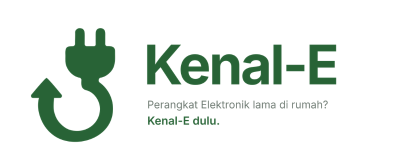
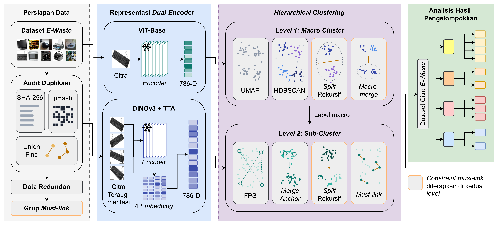

<p align="center">
  
</p>

A demo for early e-waste sorting by residents: photograph an item, review the candidate categories, save it to Cek Laci (the "drawer check"), and download a sorting report card.

## Clustering methodology

Kenal-E groups e-waste photos by category and condition without labels. It uses two frozen encoders and a two-level clustering pipeline.



1. **Data preparation.** SHA-256 and pHash find exact and near-duplicate images. Union-Find merges them into groups. Redundant copies are dropped, and each group becomes a must-link constraint so duplicates are never split.
2. **Embeddings.** ViT-Base gives a 768-D vector per image for Level 1. DINOv3 embeds four augmented views (original, horizontal flip, rotation ±10°) and averages them into a 768-D vector for Level 2.
3. **Level 1, macro clusters.** UMAP, HDBSCAN, recursive split of oversized clusters, then macro-merge of near-duplicate clusters.
4. **Level 2, sub-clusters.** Inside each macro cluster: Farthest Point Sampling for anchors, merge anchors, recursive split, then must-link constraints.

At inference, the backend embeds a new photo through the AI Space and returns the nearest reference categories as candidates that need review. Validation limits are in [ai/README.md](ai/README.md).

## Results

27 macro clusters (26 plus one noise group) and 88 sub-clusters, no labels used.

| Level 1 stage | In | Out |
|---|---|---|
| HDBSCAN | - | 21 |
| Recursive split | 21 | 40 |
| Macro-merge | 40 | 26 + noise |
| Must-link | 27 | 27 |

Level 2: FPS gave 103 anchors, merged to 56 sub-clusters, then recursive split brought it to 88. In the handheld-devices cluster, the dominant sub-cluster dropped from 78% to 14.2% and split into 17 condition-based sub-clusters.

| Test | Level 1 (ViT-Base) | Level 2 (DINOv3) |
|---|---|---|
| Silhouette | 0.2367 | 0.2615 |
| Permutation p-value | 0.0196 | 0.0099 |
| Bootstrap ARI | 0.8399 ± 0.0914 | 0.4142 ± 0.0777 |

- Hopkins statistic is 0.8616 (ViT-Base) and 0.8449 (DINOv3) against a random baseline near 0.70, so the clusters are not random.
- Both levels are significant (p < 0.05). Silhouette is under 0.3, so separation is moderate.
- Level 2 adds more explained variance in DINOv3 (R² +0.0751) than in ViT-Base (+0.0449). ViT-Base captures category; DINOv3 captures condition.
- Sub-clusters under the same parent are much more similar than those under different parents (Δ 0.5553 and 0.4588, p = 0.0002).
- Attention maps: ViT-Base focuses on overall shape; DINOv3 follows crack lines on broken phone screens.
- The dataset is uneven: handheld devices (13.15%), PCB (9.44%), mouse (8.61%), and washing machines (7.78%) are about 39% of it.

## Read more

- [Full paper](report/report.pdf): method, all tables, attention-map figures, and the MLOps design.
- Slides: [PPTX](report/slides.pptx) or [PDF](report/slides.pdf), short overview of the project.

## Run

From the repository root, once dependencies are installed:

```bash
./dev.sh
```

Frontend: http://localhost:5173. Backend and Swagger: http://localhost:8000/docs. `Ctrl+C` stops both. The HF Space runs the encoder, so your laptop does not need PyTorch for `fe` and `be`.

First-time setup on a new machine:

```bash
python3 -m venv be/.venv
be/.venv/bin/pip install -r be/requirements-dev.txt
npm --prefix fe ci
```

Set `HF_TOKEN` in the `.env` file at the repository root. An example configuration is in `.env.example`; do not overwrite a token that is already set.

Detailed documentation: [frontend](fe/README.md), [backend](be/README.md), [AI Space](ai/README.md).

Render Free backend deployment: [guide](be/DEPLOY_RENDER.md), using the `render.yaml` Blueprint at the root. The NPZ and metadata used for deployment live in `be/data/artifacts`; the frontend stays on Vercel.

## Demo status

The four pages and the detail panel are implemented. Result candidates are marked as needing review because the thresholds have not yet been calibrated on new photos. Risk metadata is still a draft. Prices, verified drop-off points, licensed reference photos, and attention maps are not yet available; the UI provides matching placeholder states. Cek Laci data is stored on the user's device. There are no accounts and no backend database.

## License

[MIT](LICENSE)
